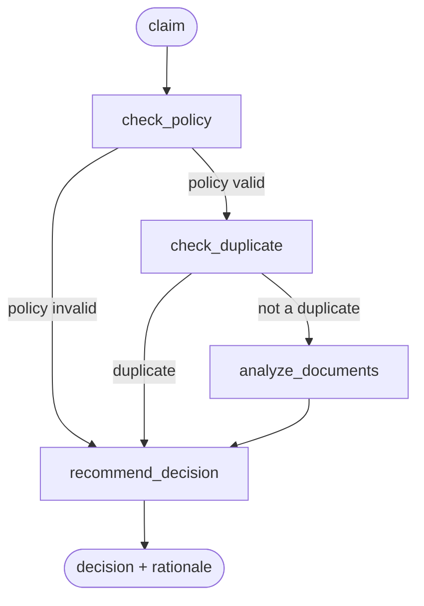

# Insurance Claims Decision Agent

A coded agent (LangGraph on the UiPath platform) that reviews an insurance claim and returns **`approve`**, **`reject`** or **`manual_review`** together with a written rationale. Policy and claim-history data come from two UiPath Data Fabric entities, an LLM checks the supporting documents for missing items and fraud signals, and the final decision follows explicit rules. It was built as the Phase 2 project of a UiPath agentic-automation training program.

## Flow



| Node | What it does |
|---|---|
| `check_policy` | Runs an input guardrail, then looks the policy up in the **Policies** Data Fabric entity. The policy must exist, be `Active`, cover the incident date (`StartDate` ≤ date ≤ `EndDate`), and the claim amount must not exceed `CoverageAmount`. |
| `check_duplicate` | Looks for an earlier claim with the same policy number and incident date in the **ClaimsHistory** entity. |
| `analyze_documents` | Sends the document texts to GPT-4.1-mini (`gpt-4.1-mini-2025-04-14`, through UiPath's `UiPathAzureChatOpenAI`). Returns the missing document types (expected: damage report, repair estimate, incident description), a fraud-risk score from 0.0 to 1.0, and short findings. |
| `recommend_decision` | Applies the rules below and writes the rationale. |

### Decision rules (`nodes/recommend_decision.py`)

1. Policy invalid → `reject`
2. Duplicate claim → `manual_review`
3. Missing documents → `manual_review`
4. Fraud-risk score ≥ 0.5 → `manual_review`
5. Otherwise → `approve`

**Input** (`models.py`): `policy_number`, `claimant_name`, `claim_amount`, `incident_date` (ISO date), `document_texts` (list of strings).
**Output:** `decision`, `rationale`, `policy_valid`, `is_duplicate`, `fraud_risk_score`.
Prompts and rationales are in Turkish (written without diacritics).

### Guardrail

A PRE-stage custom guardrail ("Claim input sanity check", block action) stops the run when `claim_amount <= 0` or when `policy_number`, `claimant_name` or `incident_date` is missing. `data/sample_claims/guardrail-invalid-amount.json` triggers it.

## Evaluation

`evaluations/` holds a smoke-test set with **5 scenarios** and **2 evaluators** in UiPath's evaluation format:

| Scenario | Expected decision |
|---|---|
| Valid policy, complete documents, no duplicate | `approve` |
| Expired policy (skips the duplicate and document steps) | `reject` |
| Same policy and incident date as an existing claim | `manual_review` |
| Only 1 of 3 required documents provided | `manual_review` |
| Inconsistent dates and damage description | `manual_review` |

Evaluators: `DecisionExactMatch` (exact match on `decision`) and `TrajectoryCheck` (an LLM judge, `gpt-4.1-mini`, checks the step sequence). **Evaluation results are not stored in this repository.** `data/sample_claims/` holds six fictional example inputs.

## Run it

Needs a UiPath Automation Cloud tenant with LLM access and the two Data Fabric entities described below, Python ≥ 3.11 and [uv](https://docs.astral.sh/uv/).

```bash
uv sync
uipath auth       # log in; the connection settings are written to .env (see .env.example)
uipath init       # regenerates the files listed in .gitignore
uipath run agent --file data/sample_claims/happy-path.json
```

Run `uipath run --help` and `uipath eval --help` for the exact options of your CLI version.

### Data Fabric entities (not included)

| Entity | Fields used |
|---|---|
| Policies | `PolicyNumber`, `Status`, `StartDate`, `EndDate`, `CoverageAmount` |
| ClaimsHistory | `PolicyNumber`, `IncidentDate` |

The entity IDs are hard-coded at the top of `nodes/check_policy.py` and `nodes/check_duplicate.py`. They belong to the author's tenant, so replace them with your own. The evaluation scenarios assume rows like these (inferred from the scenario descriptions; the rows themselves are not in this repository): `POL-1001` active with an earlier claim on 2026-02-10, `POL-1002` expired, `POL-1003` active with coverage of at least 60,000.

## Known limitations

- **Fail-open parsing:** if the model's reply is not valid JSON, `analyze_documents` falls back to "no missing documents, risk 0.0". A claim can then be approved without a real document check. A production version should send that case to manual review.
- The Data Fabric lookups fetch up to 1,000 records and filter them in Python.
- Duplicates are detected only by policy number and incident date.
- The 0.5 fraud threshold is fixed and the LLM's risk score is not calibrated.
- This repository contains only the agent. There is no process orchestration (BPMN/Maestro) or human-review task; the input and output models are written as contracts for such a caller, but it is not part of this code.

## Türkçe özet

UiPath üzerinde çalışan, LangGraph ile yazılmış bir sigorta hasar karar ajanı. Poliçeyi ve hasar geçmişini iki Data Fabric varlığından kontrol eder, belgeleri GPT-4.1-mini ile eksik evrak ve sahtecilik riski açısından inceler ve açık kurallarla **onay / red / manuel inceleme** kararı üretir. Girdi doğrulaması için PRE aşamalı bir guardrail, 5 senaryoluk bir değerlendirme seti ve 2 değerlendirici içerir. Değerlendirme sonuçları depoda yoktur; bilinen sınırlar yukarıda listelenmiştir.

## License

No license is specified.
